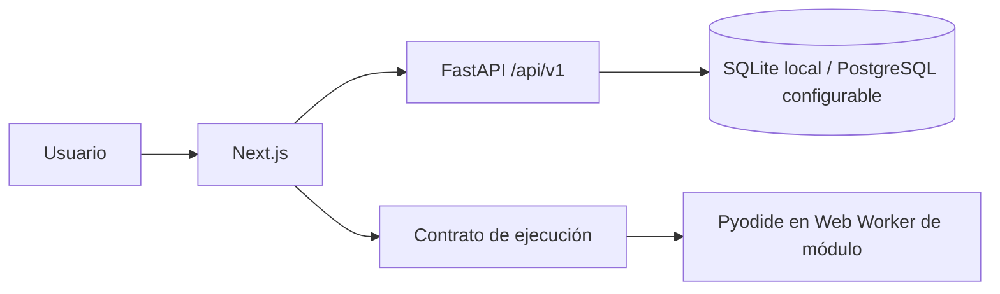

# Arquitectura inicial

Estado: PR-003 incorporó identidad y sesiones; PR-004 añadió preferencias y una recomendación por reglas; PR-005 incorporó el catálogo curricular de solo lectura; PR-006 añadió el mapa visible y un editor de borradores locales; PR-007 ejecuta Python en el navegador con Pyodide dentro de un Web Worker; PR-008a añadió ejercicios con pruebas públicas a la API del currículo; PR-008b los evalúa en el navegador y muestra retroalimentación por prueba.

## Límites actuales

`frontend/` sirve la página inicial, formularios de identidad, cuestionario de preferencias, mapa de aprendizaje y editor de Python. El borrador del editor queda solo en el navegador, y el código se ejecuta también allí. `backend/` publica salud, identidad, onboarding y currículo publicado. Usuarios, sesiones, preferencias y estructura curricular persisten mediante SQLAlchemy y migraciones Alembic. SQLite permite desarrollo local; el URL de PostgreSQL es configurable pero aún no tiene una prueba de integración. El backend no ejecuta ni recibe código del estudiante.

## Dirección de las dependencias

La interfaz llama contratos HTTP versionados. Los casos de uso futuros contendrán reglas y dependerán de interfaces de persistencia cuando aporten valor. La infraestructura implementará esas interfaces. No se crearán capas o módulos vacíos antes de necesitarlos.

## Modelo y contratos previstos

Identidad: `User`, `AuthSession` y `UserProfile` ya están migrados. Currículo: `LearningPath`, `Module`, `Lesson`, `LessonPrerequisite` y `Exercise` ya tienen persistencia. Progreso: `ExerciseProgress` guarda el último intento por persona y ejercicio ([ADR-0008](decisions/0008-self-reported-progress.md)). Los detalles de claves y restricciones están en [data-model.md](data-model.md).

Los contratos de salud, identidad, onboarding, currículo y progreso usan `/api/v1` y se describen en [api-contracts.md](api-contracts.md). El contrato de ejecución local vive en `frontend/src/lib/execution/contract.ts`. La solicitud incluye versión del contrato, identificador de ejecución, modo, `exerciseId` opcional y código; el resultado devuelve estado, salida estándar y de errores, error estructurado con la línea del estudiante, duración, recorte, motor y diagnósticos. `WorkerPythonRunner` lo implementa sobre un Web Worker con Pyodide; la interfaz no depende de Pyodide. Desde PR-008b, `evaluate` recibe las pruebas de un ejercicio y devuelve un resultado por prueba ([ADR-0007](decisions/0007-exercise-checks.md)). Detalles y límites en [ADR-0006](decisions/0006-pyodide-web-worker.md).

## Seguridad y operación

El backend no ejecuta código del estudiante. Las contraseñas se guardan con Argon2id y los tokens de sesión se guardan solo como hashes. CORS y la comprobación de origen restringen solicitudes del navegador; la cookie es HttpOnly y SameSite Lax. Los límites y controles pendientes se documentan en [security.md](security.md). El navegador no será fuente confiable para certificados de alta integridad. Antes de un evaluador remoto se requerirá un análisis específico de amenazas.

## Pruebas

PR-003 añadió pruebas de identidad. PR-004 comprueba reglas, migración, propiedad y actualización de perfiles, validación y eliminación en cascada. PR-005 comprueba migración, publicación, orden, paginación y prerrequisitos con una base SQLite temporal. Lint, tipos y build verifican el frontend. PR-007 añade `npm test` (`node --test` con eliminación de tipos de Node): el arnés se prueba con Pyodide real en Node y el controlador con un worker simulado.
