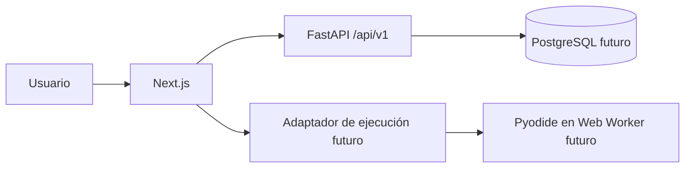

# Arquitectura inicial

Estado: propuesta aplicada únicamente a la base del PR-001. Los módulos funcionales se incorporarán cuando existan casos de uso comprobables.

## Límites actuales

`frontend/` sirve una página inicial. `backend/` publica una comprobación de salud. No hay persistencia, autenticación ni ejecución de código. El frontend aún no llama a la API.

## Dirección de las dependencias

La interfaz llama contratos HTTP versionados. Los casos de uso futuros contendrán reglas y dependerán de interfaces de persistencia cuando aporten valor. La infraestructura implementará esas interfaces. No se crearán capas o módulos vacíos antes de necesitarlos.

## Modelo y contratos previstos

Identidad: `User` y `UserProfile`. Contenido: `LearningPath`, `Module`, `Lesson` y `Exercise`. Evidencia: `ExerciseAttempt` y `LessonProgress`. Las claves, restricciones y política de eliminación se decidirán antes de la primera migración. PostgreSQL y Alembic se incorporarán en el PR que necesite persistencia.

El primer contrato HTTP real es `GET /api/v1/health`, que responde `{"status":"ok"}`. Los contratos de identidad, contenido y progreso se definirán con sus casos de uso. El contrato de ejecución local incluirá identificador de ejercicio, código, versión y modo; devolverá estado, salida, errores, duración y diagnósticos. Su implementación se decidirá en PR-007.

## Seguridad y operación

El backend no ejecutará código del estudiante. CORS acepta únicamente los orígenes configurados. La comprobación de salud es pública y no revela secretos. El navegador no será fuente confiable para certificados de alta integridad. Antes de un evaluador remoto se requerirá un análisis específico de amenazas.

## Pruebas

PR-001 comprueba el endpoint público y el esquema OpenAPI, además de lint, tipos y build del frontend. Los PRs funcionales añadirán pruebas de reglas, integración y recorridos de usuario según sus riesgos reales.
