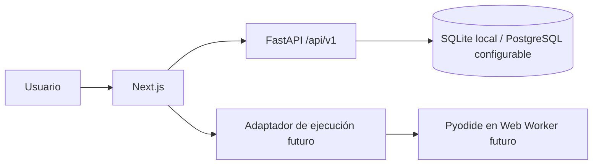

# Arquitectura inicial

Estado: PR-003 incorporó identidad y sesiones; PR-004 añadió preferencias y una recomendación por reglas; PR-005 incorpora el catálogo curricular de solo lectura.

## Límites actuales

`frontend/` sirve la página inicial, formularios de identidad y cuestionario de preferencias. `backend/` publica salud, identidad, onboarding y currículo publicado. Usuarios, sesiones, preferencias y estructura curricular persisten mediante SQLAlchemy y migraciones Alembic. SQLite permite desarrollo local; el URL de PostgreSQL es configurable pero aún no tiene una prueba de integración. No hay ejecución de código del estudiante.

## Dirección de las dependencias

La interfaz llama contratos HTTP versionados. Los casos de uso futuros contendrán reglas y dependerán de interfaces de persistencia cuando aporten valor. La infraestructura implementará esas interfaces. No se crearán capas o módulos vacíos antes de necesitarlos.

## Modelo y contratos previstos

Identidad: `User`, `AuthSession` y `UserProfile` ya están migrados. Currículo: `LearningPath`, `Module`, `Lesson` y `LessonPrerequisite` ya tienen persistencia. Los ejercicios, intentos y progreso se añadirán cuando existan sus flujos. Los detalles de claves y restricciones están en [data-model.md](data-model.md).

Los contratos de salud, identidad, onboarding y currículo usan `/api/v1` y se describen en [api-contracts.md](api-contracts.md). El contrato de ejecución local incluirá identificador de ejercicio, código, versión y modo; devolverá estado, salida, errores, duración y diagnósticos. Su implementación se decidirá en PR-007.

## Seguridad y operación

El backend no ejecuta código del estudiante. Las contraseñas se guardan con Argon2id y los tokens de sesión se guardan solo como hashes. CORS y la comprobación de origen restringen solicitudes del navegador; la cookie es HttpOnly y SameSite Lax. Los límites y controles pendientes se documentan en [security.md](security.md). El navegador no será fuente confiable para certificados de alta integridad. Antes de un evaluador remoto se requerirá un análisis específico de amenazas.

## Pruebas

PR-003 añadió pruebas de identidad. PR-004 comprueba reglas, migración, propiedad y actualización de perfiles, validación y eliminación en cascada. PR-005 comprueba migración, publicación, orden, paginación y prerrequisitos con una base SQLite temporal. Lint, tipos y build verifican el frontend.
